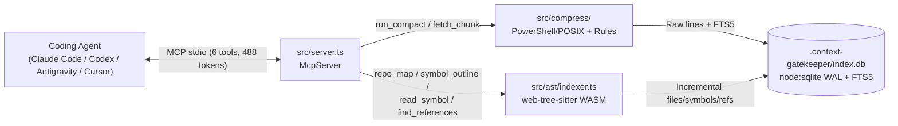

# Architecture — Context-Gatekeeper-MCP

## System Overview

---

## Zero-Native Windows Design

- **SQLite FTS5 (`node:sqlite`):** Uses Node 22+'s built-in `DatabaseSync` in `WAL` mode (`synchronous = NORMAL`, `foreign_keys = ON`, `busy_timeout = 5000`). No `node-gyp` or Visual Studio C++ Build Tools required.
- **Tree-sitter (`web-tree-sitter@0.24.7` + `tree-sitter-wasms@0.1.13`):** Loads prebuilt `.wasm` grammars (`typescript`, `tsx`, `javascript`, `c_sharp`) on demand. Syntax `Tree` and `Parser` WASM allocations are explicitly `.delete()`d in `finally` blocks.
- **PowerShell-safe Execution:** On Windows, `run_compact` executes commands via `powershell.exe -NoProfile -NonInteractive -Command` with `windowsHide: true`, line-buffered ANSI/CR stripping, and `taskkill /T /F` timeout cleanup.

---

## SQLite Schema (`.context-gatekeeper/index.db`)

### 1. Scratch Artifact & FTS5 Store
- `artifacts (id, command, cwd, exit_code, duration_ms, raw_bytes, raw_lines, summary_bytes, created_at)`
- `artifact_lines (id, artifact_id, line_no, stream, text)`
- `artifact_lines_fts USING fts5(text, artifact_id UNINDEXED, line_no UNINDEXED, tokenize='unicode61 tokenchars ''_.-/''')` — synchronized via `AFTER INSERT` / `AFTER DELETE` triggers; omits `:` from `tokenchars` so colon-suffixed error codes (`TS2345:`, `CS1002:`) match cleanly.

### 2. Incremental AST Symbol & Reference Store
- `files (id, rel_path, lang, sha256, mtime_ms, line_count, indexed_at)`
- `symbols (id, file_id, name, qualified_name, kind, signature, is_exported, start_line, end_line, parent_id)`
- `symbol_refs (id, file_id, symbol_name, line_no, col_no, snippet)`

Incremental indexing skips unchanged files in `O(1)` stat time via `mtime_ms`, falls back to `sha256` content hashing when mtimes change without edits, respects `.gitignore` + default ignores (`node_modules`, `dist`, `bin`, `obj`, `.context-gatekeeper`), and prunes deleted files.

---

## Measured Benchmarks (`gpt-tokenizer` `o200k_base`)

### Tool-Schema Overhead
- Total `tools/list` JSON schema payload across all 6 tools: **488 `o200k_base` tokens**.

### Output Compression (`npm run bench`)
| Scenario | Raw Tokens | Compressed Tokens | Reduction | Diagnostics |
| :--- | ---: | ---: | ---: | :---: |
| `dotnet build` (verbose + 2 errors + 20 warnings) | 5,126 | 248 | **95.2%** | PASS |
| `vitest run` (176 passing + 2 failing) | 3,274 | 125 | **96.2%** | PASS |
| `git diff` (lockfile noise + source hunk) | 5,899 | 105 | **98.2%** | PASS |
| **Total** | **14,299** | **478** | **96.7%** | **PASS** |

### AST Navigation (`npm run bench`)
| Scenario | Raw Full-File Tokens | AST Nav Tokens | Reduction | Status |
| :--- | ---: | ---: | ---: | :---: |
| 6-file TS + C# `repo_map` → `symbol_outline` → `read_symbol` | 5,560 | 608 | **89.1%** | PASS |

---

## Cross-Checking with `TokenHUD`

To verify real-world session savings alongside `TokenHUD`:
1. Run a baseline exploration/build/test session without `context-gatekeeper` and record `TokenHUD` input/tool-result token totals.
2. Enable `context-gatekeeper` in your client's MCP config, repeat the same task using `run_compact` / `fetch_chunk` and `repo_map` → `symbol_outline` → `read_symbol`, and compare `TokenHUD` tool-output + file-read tokens against the `o200k_base` benchmark baseline.
